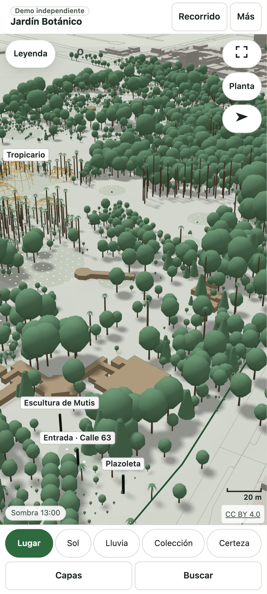
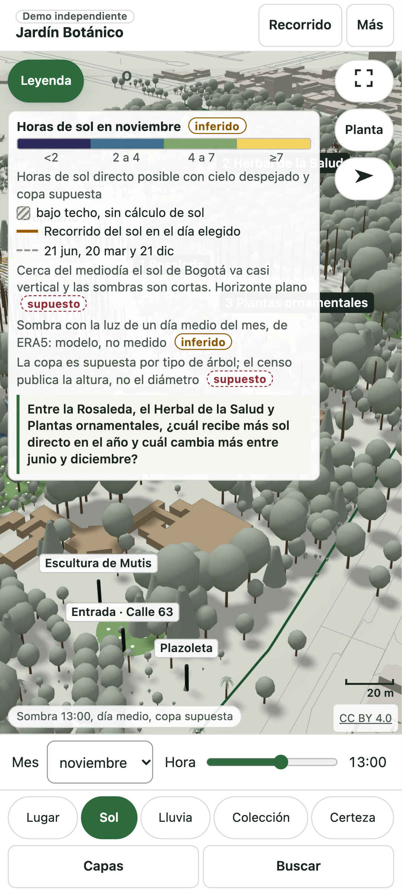
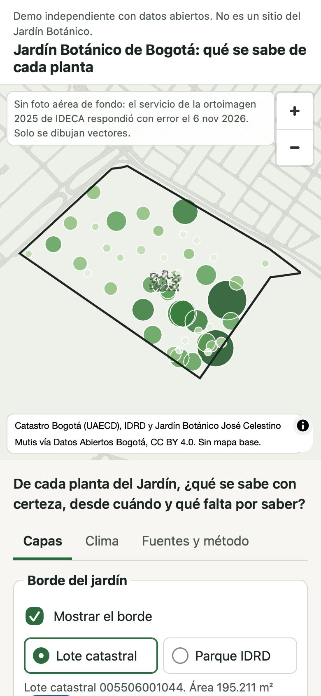
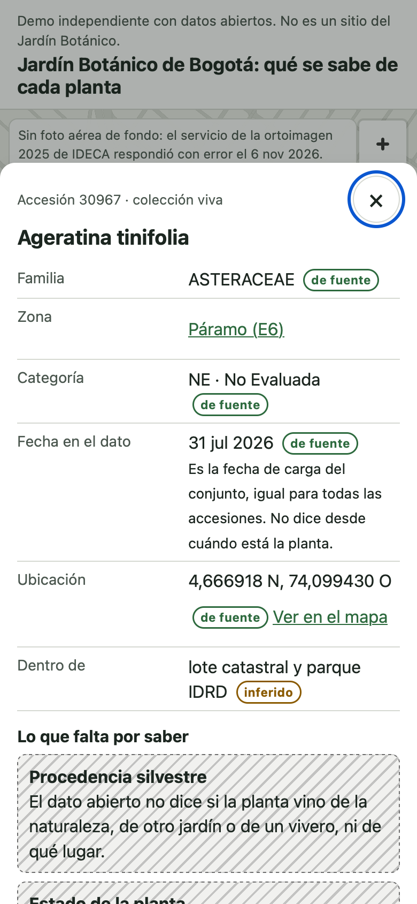

# Jardín Botánico de Bogotá: qué se sabe de cada planta

Visor web hecho solo con datos abiertos sobre el Jardín Botánico José Celestino Mutis de Bogotá.

Míralo aquí: https://caamanoluismiguel.github.io/jardin-botanico-bogota-visor/

La página principal es el visor 3D. El plano del jardín en 2D está en [`visor/`](https://caamanoluismiguel.github.io/jardin-botanico-bogota-visor/visor/) y también se abre desde el botón «Más» del 3D.

**Es una demo independiente.** No es un sitio del Jardín Botánico, no está avalada por él, no usa su logo y no habla por él. Complementa el [Geoportal Bosques Urbanos](https://geoportal.jbb.gov.co/), no lo reemplaza: para consultar el arbolado de la ciudad, ese es el lugar.

La pregunta que guía el visor es esta: de cada planta del Jardín, ¿qué se sabe con certeza, desde cuándo y qué falta por saber? Cada cifra lleva su fuente, su fecha y una marca que dice si es medida, dicha por la fuente, inferida al cruzar fuentes o supuesta.

<p>




</p>

## Qué muestra

En el visor 3D:

- El lote del jardín con su relieve, los edificios de Catastro, las zonas de la colección viva y los árboles del censo con la altura que registra el censo.
- Cuatro lentes: Certeza, Colección, Conservación y Sol, con mes y hora para ver la sombra.
- Fichas por zona, accesión y árbol, que también se abren por URL.
- Algunos árboles no se dibujan para proteger especies sensibles.
- Desde la v2: las dos entradas (Calle 63 con su plazoleta y Carrera 70), las cúpulas del Tropicario, curvas de nivel, la sombra aclarada según el cielo típico de cada mes (ERA5), el reloj de la lluvia por hora en El Dorado y una capa aparte de OpenStreetMap, apagada por defecto. Los archivos nuevos son `datos/lugar.json`, `datos/tropicario.json`, `datos/curvas.json`, `datos/cielo.json`, `datos/lluvia_hora.json` y la carpeta `datos/osm/`; el detalle está en [DATOS.md](DATOS.md).
- Desde la v2.1: las orillas de los dos lagos y los dos estanques calcadas a mano (sin el agua de OpenStreetMap), 16 techos que Catastro no tiene, el piso duro, el borde de la plazoleta y una ficha del lote visto desde arriba (copa, pasto, agua, piso, techos, sellado y escorrentía). Los archivos nuevos son `datos/calcos.json` y `datos/superficie.json`.
- El contorno del Tropicario, los puntos de las entradas y todo lo de `datos/calcos.json` y `datos/superficie.json` se calcaron o midieron sobre la Ortoimagen 2025 de Bogotá, pero la foto no se muestra ni viene en este repo.

En el plano 2D:

- El borde del jardín según el lote catastral, con el parque del IDRD como borde alterno.
- La colección viva agrupada por zona, con lentes de colección, conservación, certeza y contexto en el parque Simón Bolívar.
- Los árboles del censo del arbolado urbano, bajo pedido.
- Fichas por accesión, árbol y zona, que también se abren por URL: `?accesion=30967`, `?arbol=10010103000694`, `?zona=E6`.
- Sol y sombra en 3D con los edificios de Catastro y copas supuestas, y las horas de sol de cada zona en un día que eliges.
- Clima sin cuenta: el último parte del aeropuerto El Dorado en vivo, lluvia mensual estimada, radiación y nubosidad modeladas, e imagen de nubes.
- Una pestaña de fuentes y método con todas las cifras, lo que no se usó y por qué, y lo que falta por saber.

## Cómo correrlo en local

Solo necesitas Python 3 y un navegador.

Desde la raíz del repo:

```
python3 -m http.server 8765
```

Luego abre `http://127.0.0.1:8765/` para el 3D y `http://127.0.0.1:8765/visor/` para el plano.

El visor 3D viene ya armado: `index.html`, `assets/` y los archivos de `datos/`. Lleva three 0.187.0 empaquetado; su licencia está en [LICENCIAS-TERCEROS.txt](LICENCIAS-TERCEROS.txt). La lista de fuentes del 3D, legible por máquina, está en `datos/licencias.json`.

El plano 2D es HTML, CSS y JavaScript estáticos, sin paso de compilación. MapLibre GL 4.7.1 y three 0.170.0 se cargan desde jsDelivr con versión exacta. El mapa no tiene fondo de teselas.

## Cómo rehacer los datos

Todo se corre desde la raíz del repo. Lo descargado queda en `datos-crudos/`, que git ignora.

1. `python3 -I analisis/limite/bajar_bordes.py` baja el lote catastral, el parque del IDRD y la huella del Tropicario a `datos/limite/`. Esos tres archivos ya vienen en el repo.
2. `python3 -I analisis/clima/power_punto.py 2025` baja la radiación y la nubosidad de NASA POWER.
3. `python3 -I analisis/clima/chirps_mensual.py` lee la lluvia mensual de CHIRPS v3. Este es el único paso que necesita una librería externa: `pip install -r analisis/clima/requirements.txt` (rasterio).
4. `python3 -I visor/build/bajar.py` baja la colección viva, el censo, las construcciones, los sectores del parque, las calzadas, el METAR, la imagen de GIBS y los conteos de iNaturalist. Con `--todo` vuelve a bajar todo.

Los pasos 1, 2 y 4 usan solo la biblioteca estándar. Ningún paso pide cuenta, clave ni token.

Con eso tienes los mismos datos crudos que usa el visor. Los guiones que los convierten en los archivos servidos (`visor/datos/` del plano y `datos/` del 3D) y la comprobación de plantas amenazadas no están en este repo. Cada archivo del 3D trae su fuente, el nombre de su guion, su versión y su sha256 en `datos/manifiesto.json`.

Las fuentes cambian: la colección y el censo se actualizan cada año, el METAR cada hora y la imagen de nubes cada día. Si rehaces los datos otro día, algunas cifras pueden cambiar.

## Plantas amenazadas

La colección publica la categoría de amenaza de cada accesión. Para no señalar dónde está una planta amenazada:

- Las accesiones CR, EN, VU y EW salen sin coordenada y solo se cuentan por zona.
- Algunos árboles del censo no se dibujan y algunas accesiones salen sin punto, para proteger especies sensibles. El visor solo dice cuántos árboles dibuja de los que trae el censo.
- Cada zona se dibuja como un círculo de ubicación aproximada, nunca encima de una planta reconocible.
- Antes de publicar, una comprobación recorre todo lo que sirve el visor y debe dar 0 coincidencias.

## Fuentes

Cada fuente conserva su licencia. El detalle, con enlaces, está en [DATOS.md](DATOS.md). Atribución de cada una:

- «Colecciones vivas, Jardín Botánico José Celestino Mutis, Datos Abiertos Bogotá, CC BY 4.0»
- «Censo del arbolado urbano, Jardín Botánico José Celestino Mutis, Datos Abiertos Bogotá, CC BY 4.0»
- «Lotes, Catastro Bogotá (UAECD), CC BY 4.0»
- «Construcciones, Catastro Bogotá (UAECD), CC BY 4.0»
- «Parques de Bogotá, IDRD, Datos Abiertos Bogotá, CC BY 4.0»
- «Mapa de Referencia IDECA (calzadas), Catastro Bogotá, CC BY 4.0»; en el 3D: «Mapa de Referencia de Bogotá, versión 06.26. IDECA, con datos de SDP, SDM, IDU, EAAB, 4-72, TransMilenio S.A. y UAECD. Datos Abiertos Bogotá, CC BY 4.0»
- «Modelo Digital de Terreno 2025, IDECA, CC BY 4.0»
- «Ortoimagen urbana de Bogotá 2025, 5 cm. Propietaria: Secretaría Distrital de Planeación. Producida por SIGLA S.A.S. (contrato 1047 de 2024). Publicada por IDECA, Unidad Administrativa Especial de Catastro Distrital. Datos Abiertos Bogotá, CC BY 4.0». Solo se publica lo calcado sobre ella; la foto no se muestra.
- «Planos de diseño JBB-CTO-582-2014 (DARP, 2015) y licencia 15-5-0338, publicados en SECOP I, proceso 15-1-134214»: documentos públicos (Ley 1712 de 2014), se citan solo cifras.
- «METAR SKBO (El Dorado) vía Iowa Environmental Mesonet, Iowa State University»
- «CHIRPS v3, Climate Hazards Center, UC Santa Barbara, CC BY 4.0»
- «Contiene información modificada del Servicio de Cambio Climático de Copernicus, 2026. Ni la Comisión Europea ni el ECMWF son responsables del uso que se haga de la información de Copernicus ni de los datos que contiene» (ERA5, CC BY 4.0, en el 3D)
- «Datos obtenidos del proyecto POWER del NASA Langley Research Center, financiado por el programa NASA Earth Science/Applied Science» (plano 2D)
- «© Colaboradores de OpenStreetMap, ODbL»: solo la capa `datos/osm/` del 3D, bajo ODbL 1.0.
- «Imágenes de NASA Global Imagery Browse Services (GIBS), parte de ESDIS»
- iNaturalist: solo se cuentan las observaciones del lugar 170214 por licencia; no se copia ninguna observación ni foto.
- Algoritmo solar de la NOAA, dominio público.

## Licencia

El código y el diseño de este repo son © 2026 Luis Miguel Caamaño y Raúl Alejandro González, todos los derechos reservados. Puedes verlo y correrlo en local para conocerlo. Los datos de terceros conservan su propia licencia, listada en [DATOS.md](DATOS.md). Lee [LICENSE](LICENSE).

## Autoría

Luis Miguel Caamaño y Raúl Alejandro González
